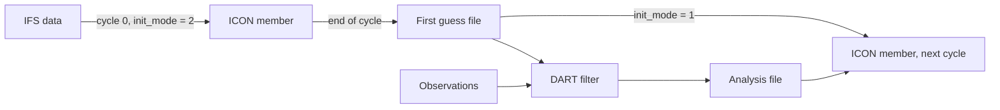

# ICON

WRF-Ensembly can run its assimilation cycle with the [ICON](https://www.icon-model.org/) model instead of WRF, in limited-area mode with the NWP physics. The cycle, the commands and the experiment directory are the same as for WRF. This page describes what is different.

Set the model in the configuration and start from the `icon` template:

```toml
[metadata]
model = "icon"
```

```bash
wrf-ensembly $EXP experiment create icon
```

## What you need

| What | Where it goes |
| --- | --- |
| An ICON build (`bin/icon`, ecRad data) | `directories.icon_root` |
| DART with `models/icon/work` built | `directories.dart_root` |
| Grid and external parameter files (e.g. from ZONDA) | `icon.grid_file`, `icon.extpar_file` |
| IFS GRIB files from MARS for the whole experiment | `icon.ifs_grib` |
| DWD's ecCodes definitions | `icon.dwd_grib_definitions` |
| CDO and the ecCodes tools on the `PATH` (preprocessing only) | `slurm.env_modules` |

Only one domain is supported, no nests.

## How a cycle works

ICON has its own way of starting from a short forecast and an analysis, the one its operational data assimilation uses. WRF-Ensembly goes through it instead of editing restart files:



1. **First cycle.** Every member starts from IFS data that was interpolated to the ICON grid (`init_mode = 2`). ICON does the vertical interpolation.
2. **End of each cycle.** Every member writes a *first guess* file on the native grid: the prognostic state (edge-normal wind `vn`, `w`, `rho`, `theta_v`, tracers, soil and surface) plus the diagnostic `u`, `v`, `temp`, `pres` on cells and the level heights `z_ifc`.
3. **Filter.** DART reads the prior of each member from its first guess file. Observation operators use `u`, `v`, `temp`, `pres`, `qv` on cell centres.
4. **Analysis.** `ensemble analysis` writes an *analysis file* per member with the analysed `temp`, `pres`, `u`, `v` and moisture variables.
5. **Next cycle.** The member starts with `init_mode = 1`: ICON reads the first guess and the analysis file, turns the difference in `u` and `v` into an increment of `vn` (and `w`), and rebuilds `rho` and `theta_v` from the analysed temperature and pressure. Without an analysis (no observations in that cycle), it starts from the first guess alone. The start state then has exactly the analysed temperature, pressure and moisture. Of the wind increment about 85% arrives: ICON smooths the increment of `vn`, and going from cells to edges and back smooths as well.

The lateral boundaries always come from the boundary files. ICON takes the state at the start of a run as the boundary data for that time, so there is no equivalent of WRF's `update-bc` step (the command does nothing for ICON).

### Things to know

- **Cycle length.** ICON looks for boundary files at the start of a run plus multiples of `time_control.boundary_update_interval`. Every cycle must therefore be a multiple of that interval long. The configuration is rejected otherwise.
- **Surface tiles are reset every cycle.** ICON can only tell the surface tiles apart in GRIB input. With the netCDF first guess, the tiles start each cycle from the tile-averaged soil and surface fields (`ltile_coldstart = .true.`). The averaged fields themselves carry over.
- **State variables.** `assimilation.state_variables` lists what goes back into ICON. `temp`, `pres`, `u`, `v`, `qv`, `qc`, `qi`, `qr`, `qs`, `qg` go through the analysis file. Any other variable (e.g. an aerosol tracer) must be on cells and in the first guess file (`icon.first_guess_variables`); it is updated in a copy of that file. Do not put `vn`, `rho` or `theta_v` in the state: ICON derives them.
- **Ensemble spread.** There are no `[perturbations]` for ICON. Use different initial and boundary files per member (the `%MEMBER%` placeholder in `icon.ifs_grib`, `icon.initial_conditions`, `icon.boundary_conditions`), per-member namelists (`[icon.namelist_per_member.member_03.<group>]`), random noise on the initial state of the first cycle (`icon.initial_noise`, good for testing only: it has no spatial structure) and ICON's own parameter perturbations (`[icon.namelist.ensemble_pert_nml]`; every member gets its own `perturbationNumber`). Test the latter with a single run first: with icon-2026.04 and ZONDA external parameters, `use_ensemble_pert` corrupted memory on our system.
- **Segments** (several cycles in one run) are not supported.
- **Disk space.** A first guess file is large (about 1.2 GB for 300 000 cells and 50 levels). `ensemble cycle` deletes the first guess and analysis files of cycles older than the previous one, unless `assimilation.keep_restart_files` or `keep_restart_files_for_cycles` says otherwise.

## Preprocessing

```bash
wrf-ensembly $EXP preprocess icon-icbc
wrf-ensembly $EXP ensemble setup
```

`preprocess icon-icbc` reads the IFS GRIB files in `icon.ifs_grib`:

- `ifs_<YYYYMMDDHH>.grb`, the analysis on model levels with the soil and surface fields, valid at the start of the experiment. It becomes `icon.initial_conditions`.
- `ifs_*_lbc.grb`, one forecast step per file. Each one that is valid during the experiment becomes a file in `icon.boundary_conditions`, named after `icon.boundary_filename`.

Each file is converted to netCDF, its variables are renamed to what ICON expects and it is interpolated horizontally to the ICON grid (first order conservative) with CDO. The interpolation weights are computed once and reused for all files. Files that exist already are skipped unless you pass `--overwrite`.

`ensemble setup` links the executable and the input files into each member's directory. Nothing is copied by `experiment copy-model`.

You can skip `icon-icbc` and point `icon.initial_conditions` and `icon.boundary_conditions` to files you made yourself.

## Namelists

The atmosphere namelist is written from `[icon.namelist.<group>]` tables. These are filled in by WRF-Ensembly and cannot be set:

| Group | Variables |
| --- | --- |
| `grid_nml` | `dynamics_grid_filename` |
| `extpar_nml` | `extpar_filename` |
| `initicon_nml` | `init_mode`, `ifs2icon_filename`, `dwdfg_filename`, `dwdana_filename`, `lread_ana` |
| `limarea_nml` | `latbc_path`, `latbc_filename`, `latbc_varnames_map_file`, `dtime_latbc` |

Two output streams are always there, both on the native grid, one netCDF file per time:

- `icon_<date>.nc`: `icon.output_variables` every `time_control.output_interval`. This is what gets postprocessed.
- `fg_<date>.nc`: the first guess (`icon.first_guess_variables`) at the end of the cycle.

More streams can be added as `[[icon.namelist.output_nml]]` tables. `icon_master.namelist` is generated; override parts of it with `[icon.master_namelist.<group>]`.

`slurm.mpirun_command` launches the model as `<mpirun_command> -n <cores> icon`. The I/O processes (`num_io_procs`) and the process that reads the boundary files (`num_prefetch_proc = 1`, required) are part of `<cores>`.

## DART

DART needs the ICON interface in `models/icon` (branch `icon` of our DART fork). Build it with `./quickbuild.sh` in `models/icon/work`.

`[dart_namelist.model_nml]` lists the state variables as netCDF name, DART quantity, minimum, maximum and `UPDATE` or `NO_COPY_BACK`:

```toml
[dart_namelist.model_nml]
variables = [
  "u",        "QTY_U_WIND_COMPONENT",  "NA",  "NA", "UPDATE",
  "v",        "QTY_V_WIND_COMPONENT",  "NA",  "NA", "UPDATE",
  "temp",     "QTY_TEMPERATURE",       "NA",  "NA", "UPDATE",
  "pres",     "QTY_PRESSURE",          "NA",  "NA", "UPDATE",
  "qv",       "QTY_SPECIFIC_HUMIDITY", "0.0", "NA", "UPDATE",
  "pres_sfc", "QTY_SURFACE_PRESSURE",  "NA",  "NA", "NO_COPY_BACK",
]
```

- ICON's `qv` is a specific humidity. The interface converts to a mixing ratio when an operator asks for one.
- Observations with a pressure as their vertical coordinate need `pres` in the state.
- Surface observations use `t_2m`, `u_10m`, `v_10m` and `pres_sfc` if they are in the state, otherwise the lowest model level.
- Vertical localisation is in height. Keep `convert_all_state_verticals_first` and `convert_all_obs_verticals_first` true in `assim_tools_nml`.
- Observations in the outermost `boundary_width` rows of cells are rejected (default 4).
- Model levels in locations (`VERTISLEVEL`) are counted from the ground, although ICON itself counts from the top.

The files `icon_template.nc`, `icon_heights.nc` and `icon_grid.nc` that the interface reads are linked into the work directory by `ensemble filter`.

## Postprocessing

`postprocess run` interpolates the forecast and analysis output from the triangular grid to a regular lat/lon grid, and then computes the ensemble statistics as for WRF. The output files have:

- dimensions `(t, z, y, x)`, with `x` the longitude and `y` the latitude in degrees
- `z` counting model levels from the ground, with their height in `geopotential_height`
- variables on half levels (`w`) averaged to full levels
- `temp`, `pres`, `u`, `v` renamed to `air_temperature`, `air_pressure`, `wind_east`, `wind_north`

`postprocess.variables_to_keep` is matched against these names. Points outside the model domain are missing values.

```toml
[icon.regrid]
method = "linear"
method_overrides = { "tot_prec|rain_.*|snow_.*" = "conservative" }
resolution = 0.1                   # degrees, default: the spacing of the ICON grid
bounds = [10.0, 35.0, 30.0, 45.0]  # west, east, south, north, default: the whole grid
threads = 4
```

| Method | What it does | Use it for |
| --- | --- | --- |
| `nearest` | Value of the triangle that contains the point | Categorical fields |
| `linear` | Barycentric interpolation between the three nearest cell centres | Most fields (default) |
| `conservative` | Area-weighted mean of the triangles that overlap the target cell | Precipitation, fluxes, or a target grid coarser than the model's |

The interpolation weights are computed once per method and kept in `data/regrid_weights/`. Applying them is one sparse matrix product per level, so the interpolation costs much less than reading and writing the files.

The same code can be used on its own:

```python
import xarray as xr
from wrf_ensembly.icon.regrid import IconGrid, LatLonGrid, Regridder

grid = IconGrid.from_file("grid_DOM01.nc")
regridder = Regridder.build(grid, LatLonGrid.covering(grid, 0.1), method="linear")
ds = regridder.regrid_dataset(xr.open_dataset("icon_20260913T060000Z.nc"))
```

## Plots

The `plots` commands and the map plots of `observations` and `validation` work as for WRF. Maps are drawn in plain longitude and latitude, which is what the postprocessed output is on. `observations plot-compare-obs-to-grid` draws the triangles and their cell centres. Variables on model levels need a `level` or `pressure_level` in `[plots.*]`, as for WRF.

## Not supported yet

- Nested domains
- `[perturbations]` and `[segments]`
- `ensemble setup-from-other-experiment`
- `preprocess interpolate-chem` and the other WRF/WPS preprocessing commands
