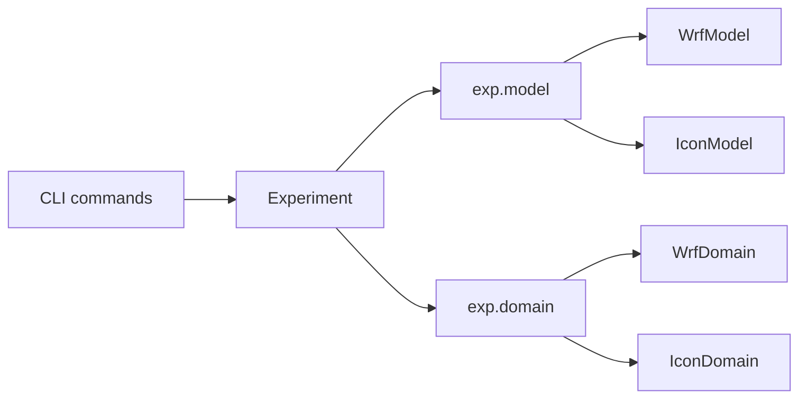

# Model interface

This page is for people who work on WRF-Ensembly itself: how the code is split between what is the same for every model and what is not, and what it takes to add a model.

## Who does what

`Experiment` owns the workflow: which cycle the experiment is on, which members have advanced, running the DART filter, planning segments. It does not know how a model is run or what its files look like. For that it asks two objects, both chosen by `metadata.model`:

| Object | Class | Where | What it answers |
| --- | --- | --- | --- |
| `exp.model` | `Model` | `wrf_ensembly/models/` | How is the model installed, set up and run? What are its output files called? How does the analysis get back into it? |
| `exp.domain` | `Domain` | `wrf_ensembly/domain.py` | What is the map projection and the extent? Which observations are inside? |

The rule that keeps this working: shared code (`Experiment`, the commands, the postprocessing, the observations) has no branches on the model. If something depends on the model, it becomes a method of `Model` or `Domain`.

## `Model`

Defined in `wrf_ensembly/models/base.py`, with `WrfModel` in `wrf.py` and `IconModel` in `icon.py`. `IconModel` is a thin layer over the functions in `wrf_ensembly/icon/`.

| Method | Called by | What it does |
| --- | --- | --- |
| `environment` | Running the model | Environment variables for the model |
| `install(force)` | `experiment copy-model` | Puts the model into the experiment directory |
| `setup_member(member_i)` | `ensemble setup` | Prepares a member's directory for the first cycle |
| `preprocess_job(command)` | `slurm preprocessing` | The lines of the preprocessing job |
| `run_member(member_i, segment, cycle, cores)` | `ensemble advance-member` | Runs a member and leaves the output of each cycle in its scratch directory. Returns a `ModelRun`, or `None` if the run failed |
| `forecast_glob`, `time_stamp`, `forecast_file_name` | Postprocessing, `status reconcile`, cleaning | Names of the forecast output files |
| `cycle_end_file_name(time)` | `status reconcile`, the model itself | The file a member must have written at the end of a cycle. Defaults to the forecast file; ICON's is the first guess |
| `first_processor()` | `postprocess run` | First step of the pipeline, which brings a file to the common layout (`t, z, y, x`, CF names) |
| `prepare_filter()` | `ensemble filter` | Puts what DART's model interface needs in the DART work directory, returns the file of each member's prior |
| `make_analysis(member_i)` | `ensemble analysis` | Combines the filter's output with the member's forecast |
| `cycle_member(member_i, use_forecast)` | `ensemble cycle` | Prepares a member for the next cycle, from the analysis or the forecast |
| `update_bc(member_i)` | `ensemble update-bc` | Makes the boundary conditions consistent with a changed initial state |
| `clean_old_state()` | `ensemble cycle` | Deletes the files that no cycle can start from anymore |

Optional features have a default that raises `NotImplementedError`:

- Perturbations: `generate_perturbations`, `generate_perturbations_for_cycles`, `apply_perturbations`. WRF has all of them; ICON perturbs the first cycle only
- Segments: `member_initial_state`, `prepare_member_boundaries`, `remove_cycle_output`. WRF only

`Config.check()` rejects the settings that would need them (`[segments]`, perturbations after the first cycle) for a model without them, so the error is at the configuration and not in the middle of a run.

## `Domain`

| Method | What it does |
| --- | --- |
| `cartopy_crs()` | The projection in which the postprocessed output has its `x` and `y` |
| `bounds()` | Extent of the domain in that projection |
| `locate(df)` | Adds `x`, `y` and `in_domain` to a dataframe of observations (`longitude`, `latitude`) |
| `plot_observations_on_grid(...)` | Observations on top of the model grid |

`WrfDomain` is a rectangle in the WRF map projection. `IconDomain` uses plain longitude and latitude, because ICON output is postprocessed to a lat/lon grid, and an observation is inside if it is in one of the grid's triangles.

## What is not behind the interface

- **Configuration.** The config sections of each model are optional in the dataclasses, and `Config.check()` requires and validates them per model.
- **Model-only commands.** The WPS and real.exe commands of `preprocess`, `preprocess icon-icbc` and `postprocess print-variables-to-keep` belong to one model and refuse to run for the other themselves.
- **DART.** Each model needs its DART interface in `models/<name>` of the DART tree. `paths.dart_work_dir` is `models/<metadata.model>/work`.

## Adding a model

1. Add its config section to `config.py` and its checks to `Config.check()`.
2. Write a `Model` subclass in `wrf_ensembly/models/` and a `Domain` subclass in `domain.py`, and add both to the `create` functions.
3. Write the first postprocessing step (`first_processor`). Everything downstream expects dimensions `(t, z, y, x)`, `x` and `y` in the projection of the domain, `z = 0` at the lowest level, and the names `air_temperature`, `air_pressure`, `wind_east`, `wind_north` and `geopotential_height` for the validation tools.
4. Add a config template in `wrf_ensembly/config_templates/`.
5. Test the cycle with a fake model: `tests/fake_wrf.py` and `tests/fake_icon.py` stand in for the executables, so `advance_member`, the analysis and the cycling run in the tests without the real model.
