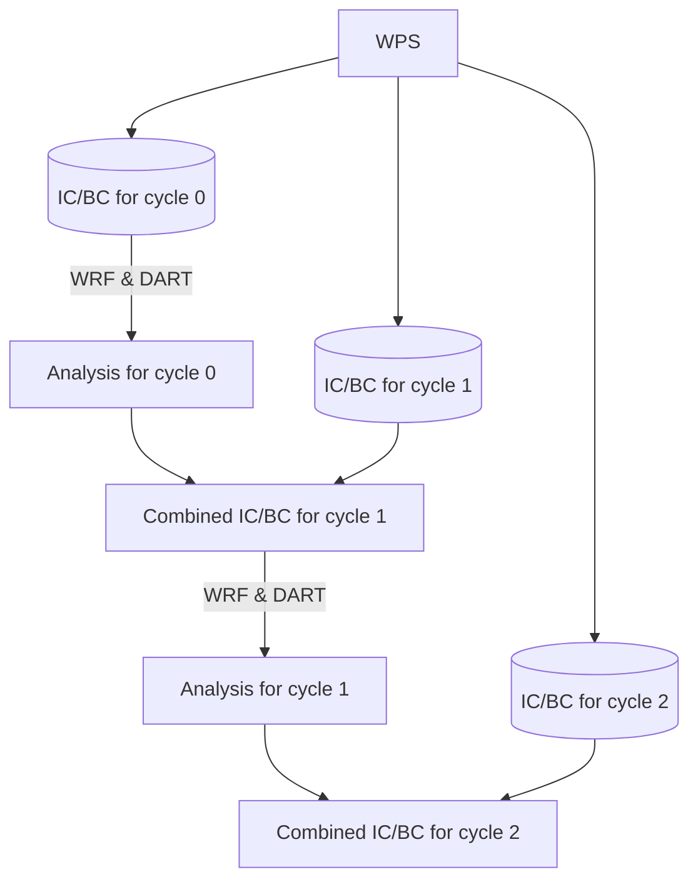
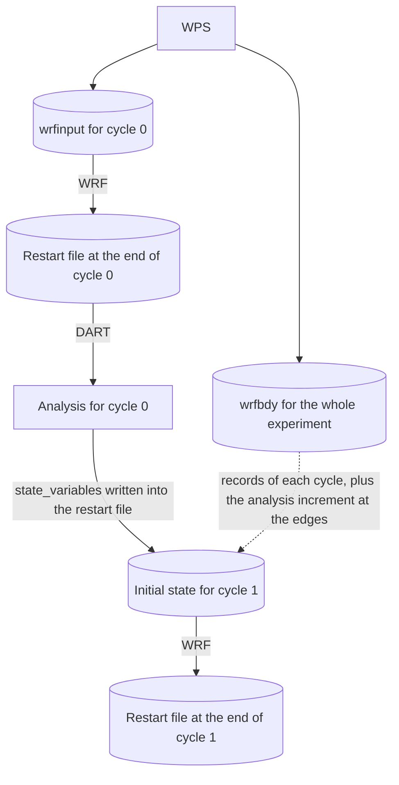

# WRF

WRF (and WRF-Chem, see [WRF-Chem](./wrf-chem.md)) is the default model, `metadata.model = "wrf"`. The cycle, the commands and the experiment directory are described in [Core Concepts](./core-concepts.md). This page describes what is specific to WRF: where the initial and boundary conditions come from and how a member continues into the next cycle.

## What you need

| What | Where it goes |
| --- | --- |
| A WRF build (the directory with `run/`) | `directories.wrf_root` |
| A WPS build (`geogrid.exe`, `ungrib.exe`, `metgrid.exe`) | `directories.wps_root` |
| DART with `models/wrf/work` built | `directories.dart_root` |
| Static geographical data for geogrid | `data.wps_geog` |
| Meteorology GRIB files for the whole experiment | `data.meteorology` |

`experiment copy-model` copies WRF and WPS into the experiment directory, so the experiment keeps working when the builds change.

## Preprocessing

```bash
wrf-ensembly $EXP preprocess setup
wrf-ensembly $EXP preprocess geogrid
wrf-ensembly $EXP preprocess ungrib
wrf-ensembly $EXP preprocess metgrid
wrf-ensembly $EXP preprocess real --cycle N   # cycling_mode = "wrfinput", for every cycle
wrf-ensembly $EXP preprocess real             # cycling_mode = "restart", once
wrf-ensembly $EXP ensemble setup
```

The WPS and WRF namelists are written from `[domain_control]`, `[time_control]`, `[data]`, `[geogrid]` and `[wrf_namelist]`. The [Tutorial](./tutorial.md) goes through these steps one by one.

## Cycling modes

How a member continues into the next cycle depends on `assimilation.cycling_mode`, see
[Cycling modes](./configuration.md#cycling-modes) for the settings.

### `wrfinput` mode: a fresh start every cycle

WRF's output doesn't include everything needed to start the model (SST, for example, is
not advanced by the model but is needed to initialise it). So real.exe makes initial and
boundary conditions for every cycle's start, and at the end of each cycle the analysis is
combined with the ones for the next cycle:



Only the `cycled_variables` come from the analysis; everything else is fresh from real.exe.
WRF starts cold every cycle, so physics state that isn't in the wrfinput (cloud droplet
number, TKE, accumulated fields, ...) starts over each time.

### `restart` mode: members continue from their own restart file

real.exe runs once, for the whole experiment: it makes the first cycle's wrfinput and one
wrfbdy for the whole period. Every member writes a WRF restart file at the end of each
cycle, which holds its complete state, and starts the next cycle from it:



`ensemble cycle` writes only the analysis' `state_variables` into the restart file and
rebalances pressure and density; everything else carries over as WRF left it. Each member
gets the boundary records of its cycle from the long wrfbdy, and `ensemble update-bc` adds
the analysis increment at the domain edges to them. When a cycle has no observations,
the restart file is used as it is, so the run continues as if it had never stopped (with
the exceptions below).

#### What a restart doesn't carry over exactly

A WRF restart is close to exact but not bitwise. Differences are tiny compared to
ensemble spread, but they show up when comparing runs:

- Fields WRF doesn't write to restart files start over at 0, for example `EDUST1`-`EDUST5`
  and `TOT_EDUST` with GOCART dust, which then hold the emissions since the last restart
  instead of since the experiment start. Fields that are restarted, like `RAINNC` and the
  deposition fluxes, keep counting from the experiment start.
- With the adaptive time step, WRF-Chem stores the time of its last chemistry step in
  whole seconds, so the first chemistry step after a restart is up to a second too long.
  This shifts OC/BC between their hydrophobic and hydrophilic forms slightly at every
  restart. Dust and sea salt are not affected.
- The meteorology can drift apart at round-off level after some restarts (seen with
  WRF-Chem and aerosol-aware microphysics, starting at the lateral boundary), and grow
  where clouds form or not. It isn't predictable which restarts do this.

[Segments](#segments) avoid most restarts, so they also avoid most of this.

## Segments

In the `restart` cycling mode, moving forward with the forecast changes nothing in the
model state, yet each stop still costs restart I/O and a round trip through the queue.
With [`[segments]`](./configuration.md#segments) enabled, the members run several cycles
as one WRF run, a *segment*, and only stop where it's needed:

- at a cycle with an observation file in `obs/` (where the filter runs), so run
  `observations prepare-cycles` before starting the experiment;
- at the cycles in `assimilation.keep_restart_files_for_cycles`;
- at the `--run-until` cycle of `slurm run-experiment`;
- at the last cycle;
- or earlier, if the run would not fit in `segments.max_walltime`.

The cycle stays the unit of everything else: each cycle still gets its own forecasts,
status files and postprocessing, so commands that take a cycle work as before. A segment
is planned when it is about to start (by `ensemble setup` and `ensemble cycle`) and the
plan is stored in `status/segments/`. `ensemble plan-segment` shows it, or plans it again
with `--replan` as long as no member has started.

While a segment runs, the experiment stays at its first cycle. Afterwards, every member
has sorted its output into the cycles it belongs to, and `ensemble finish-segment` (the
first step of the analysis job) marks the inner cycles complete and moves the experiment
to the last one, where filter, analysis and cycle run as usual.

Members write a restart file every `checkpoint_interval_hours` along the way. If a
member job dies, `run-experiment` resubmits it as usual and it continues from its newest
checkpoint that WRF finished writing. `ensemble reset-cycle` on any cycle of the segment
resets the whole segment, deleting its output and checkpoints, and plans it again.

## Ensemble spread

`[perturbations]` adds spatially correlated noise to variables of the initial state, once or at every cycle, see [Perturbations](./configuration.md#perturbations). `ensemble update-bc` then makes the boundary conditions consistent with the perturbed state. Other sources of spread are different meteorology per member (`data.per_member_meteorology`) and per-member namelists (`[wrf_namelist_per_member]`).

## Postprocessing

The first step of the [postprocessing](./postprocess.md) pipeline is `XWRFPostProcessor`: [xwrf](https://github.com/xarray-contrib/xwrf) destaggers the fields, computes diagnostics and gives the output `x` and `y` coordinates in the domain's map projection.
